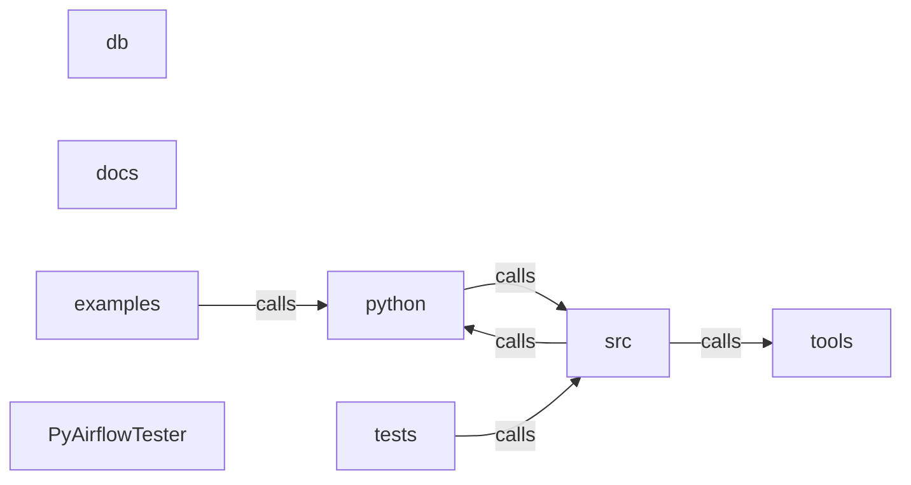

_Generated by CodeAtlas._

## Details

Architecture map of PyAirflowTester.

### db

Owns 0 symbols across 0 file(s).

**Related Classes/Methods:** _None_

### docs

Owns 0 symbols across 0 file(s).

**Related Classes/Methods:** _None_

### examples

Owns 12 symbols across 3 file(s).

**Related Classes/Methods:** _None_

**Source Files:**

- `examples/dependency_intelligence_usage.py`
  - `examples.dependency_intelligence_usage.example_1_build_graph`
  - `examples.dependency_intelligence_usage.example_2_impact_analysis`
  - `examples.dependency_intelligence_usage.example_3_blast_radius`
  - `examples.dependency_intelligence_usage.example_4_cycle_detection`
  - `examples.dependency_intelligence_usage.example_5_orphan_detection`
  - `examples.dependency_intelligence_usage.example_6_risk_scoring`
  - `examples.dependency_intelligence_usage.example_7_drift_detection`
  - `examples.dependency_intelligence_usage.example_8_advanced_queries`
  - `examples.dependency_intelligence_usage.main`
- `examples/sample_dag.py`
  - `examples.sample_dag.extract_data`
  - `examples.sample_dag.load_data`
  - `examples.sample_dag.transform_data`

### python

Owns 0 symbols across 0 file(s).

**Related Classes/Methods:** _None_

### src

Owns 186 symbols across 5 file(s).

**Related Classes/Methods:** _None_

**Source Files:**

- `src/dag_parser.rs`
  - `src.dag_parser.DagDefinition`
  - `src.dag_parser.DagDefinition.new`
  - `src.dag_parser.DagParseError`
  - `src.dag_parser.DagParser`
  - `src.dag_parser.DagParser.build_dependency_edges`
  - `src.dag_parser.DagParser.calculate_max_depth`
  - `src.dag_parser.DagParser.count_tasks`
  - `src.dag_parser.DagParser.default`
  - `src.dag_parser.DagParser.detect_cycles`
  - `src.dag_parser.DagParser.detect_dynamic_dag`
  - `src.dag_parser.DagParser.detect_expensive_imports`
  - `src.dag_parser.DagParser.detect_external_dependencies`
  - `src.dag_parser.DagParser.extract_dag_id`
  - `src.dag_parser.DagParser.extract_task_ids`
  - `src.dag_parser.DagParser.new`
  - `src.dag_parser.DagParser.parse_directory`
  - `src.dag_parser.DagParser.parse_file`
  - `src.dag_parser.extract_var_to_task_map`
  - `src.dag_parser.has_cycle_from`
  - `src.dag_parser.longest_chain`
  - `src.dag_parser.tests.test_detect_cycles_finds_cycle`
  - `src.dag_parser.tests.test_detect_cycles_none_for_acyclic`
  - `src.dag_parser.tests.test_detect_cycles_self_loop`
  - `src.dag_parser.tests.test_detect_cycles_via_set_upstream`
  - `src.dag_parser.tests.test_detect_dynamic_dag`
  - `src.dag_parser.tests.test_detect_expensive_imports`
  - `src.dag_parser.tests.test_extract_dag_id`
  - `src.dag_parser.tests.test_max_depth_diamond`
  - `src.dag_parser.tests.test_max_depth_independent_tasks_is_one`
  - `src.dag_parser.tests.test_max_depth_left_shift_operator`
  - `src.dag_parser.tests.test_max_depth_linear_chain`
  - `src.dag_parser.tests.test_max_depth_list_operand`
  - `src.dag_parser.tests.test_max_depth_no_tasks_is_zero`
  - `src.dag_parser.tests.test_max_depth_set_downstream`
  - `src.dag_parser.tests.test_max_depth_set_upstream_and_downstream`
  - `src.dag_parser.tests.test_parse_file`
- `src/dbt_parser.rs`
  - `src.dbt_parser.DbtModel`
  - `src.dbt_parser.DbtModel.new`
  - `src.dbt_parser.DbtParseError`
  - `src.dbt_parser.DbtParser`
  - `src.dbt_parser.DbtParser.build_lineage_graph`
  - `src.dbt_parser.DbtParser.parse_catalog`
  - `src.dbt_parser.DbtParser.parse_manifest`
  - `src.dbt_parser.DbtParser.parse_model_node`
  - `src.dbt_parser.DbtParser.parse_run_results`
  - `src.dbt_parser.DbtParser.parse_test_node`
  - `src.dbt_parser.DbtProject`
  - `src.dbt_parser.DbtProject.new`
  - `src.dbt_parser.DbtTest`
  - `src.dbt_parser.DbtTest.new`
  - `src.dbt_parser.tests.test_create_dbt_model`
  - `src.dbt_parser.tests.test_create_dbt_project`
  - `src.dbt_parser.tests.test_create_dbt_test`
- `src/lib.rs`
  - `src.lib.PyCategory`
  - `src.lib.PyCategory.as_str`
  - `src.lib.PyCategory.cost`
  - `src.lib.PyCategory.data_quality`
  - `src.lib.PyCategory.maintainability`
  - `src.lib.PyCategory.operational`
  - `src.lib.PyCategory.performance`
  - `src.lib.PyCategory.reliability`
  - `src.lib.PyCategory.security`
  - `src.lib.PyDagDefinition`
  - `src.lib.PyDagDefinition.__repr__`
  - `src.lib.PyDagParser`
  - `src.lib.PyDagParser.__repr__`
  - `src.lib.PyDagParser.new`
  - `src.lib.PyDagParser.parse_directory`
  - `src.lib.PyDagParser.parse_file`
  - `src.lib.PyDbtModel`
  - `src.lib.PyDbtModel.__repr__`
  - `src.lib.PyDbtModel.new`
  - `src.lib.PyDbtParser`
  - `src.lib.PyDbtParser.__repr__`
  - `src.lib.PyDbtParser.new`
  - `src.lib.PyDbtParser.parse_manifest`
  - `src.lib.PyDbtProject`
  - `src.lib.PyDbtProject.__repr__`
  - `src.lib.PyDbtProject.model_count`
  - `src.lib.PyDbtProject.test_count`
  - `src.lib.PyDbtTest`
  - `src.lib.PyDbtTest.__repr__`
  - `src.lib.PyExecutionMode`
  - `src.lib.PyExecutionMode.as_str`
  - `src.lib.PyExecutionMode.correlation`
  - `src.lib.PyExecutionMode.runtime`
  - `src.lib.PyExecutionMode.static_mode`
  - `src.lib.PyRule`
  - `src.lib.PyRule.__repr__`
  - `src.lib.PyRule.new`
  - `src.lib.PyRuleContext`
  - `src.lib.PyRuleContext.__repr__`
  - `src.lib.PyRuleContext.dag_id`
  - `src.lib.PyRuleContext.metadata`
  - `src.lib.PyRuleContext.model_name`
  - `src.lib.PyRuleContext.new`
  - `src.lib.PyRuleContext.task_id`
  - `src.lib.PyRuleContext.test_id`
  - `src.lib.PyRuleContext.with_dag`
  - `src.lib.PyRuleContext.with_metadata`
  - `src.lib.PyRuleContext.with_model`
  - `src.lib.PyRuleContext.with_task`
  - `src.lib.PyRuleContext.with_test`
  - `src.lib.PyRuleEngine`
  - `src.lib.PyRuleEngine.__repr__`
  - `src.lib.PyRuleEngine.new`
  - `src.lib.PyRuleEngine.rule_count`
  - `src.lib.PyRuleViolation`
  - `src.lib.PyRuleViolation.__repr__`
  - `src.lib.PyRuleViolation.new`
  - `src.lib.PyRuleViolation.to_dict`
  - `src.lib.PyScorer`
  - `src.lib.PyScorer.__repr__`
  - `src.lib.PyScorer.calculate_priority_score`
  - `src.lib.PyScorer.new`
  - `src.lib.PySeverity`
  - `src.lib.PySeverity.as_score`
  - `src.lib.PySeverity.as_str`
  - `src.lib.PySeverity.critical`
  - `src.lib.PySeverity.high`
  - `src.lib.PySeverity.info`
  - `src.lib.PySeverity.low`
  - `src.lib.PySeverity.medium`
  - `src.lib._core`
  - `src.lib.convert_dag_definition`
  - `src.lib.convert_dbt_model`
  - `src.lib.convert_dbt_project`
  - `src.lib.convert_dbt_test`
  - `src.lib.evaluate_rules`
- `src/rule_engine.rs`
  - `src.rule_engine.Category`
  - `src.rule_engine.Category.as_str`
  - `src.rule_engine.ExecutionMode`
  - `src.rule_engine.ExecutionMode.as_str`
  - `src.rule_engine.Rule`
  - `src.rule_engine.RuleContext`
  - `src.rule_engine.RuleContext.default`
  - `src.rule_engine.RuleContext.new`
  - `src.rule_engine.RuleContext.with_dag`
  - `src.rule_engine.RuleContext.with_metadata`
  - `src.rule_engine.RuleEngine`
  - `src.rule_engine.RuleEngine.default`
  - `src.rule_engine.RuleEngine.evaluate`
  - `src.rule_engine.RuleEngine.evaluate_by_mode`
  - `src.rule_engine.RuleEngine.new`
  - `src.rule_engine.RuleEngine.register_rule`
  - `src.rule_engine.RuleEngine.rule_count`
  - `src.rule_engine.RuleViolation`
  - `src.rule_engine.RuleViolation.new`
  - `src.rule_engine.RuleViolation.with_context`
  - `src.rule_engine.Severity`
  - `src.rule_engine.Severity.as_score`
  - `src.rule_engine.Severity.as_str`
  - `src.rule_engine.Severity.from_str_name`
  - `src.rule_engine.tests.TestRule`
  - `src.rule_engine.tests.TestRule.category`
  - `src.rule_engine.tests.TestRule.description`
  - `src.rule_engine.tests.TestRule.evaluate`
  - `src.rule_engine.tests.TestRule.execution_mode`
  - `src.rule_engine.tests.TestRule.id`
  - `src.rule_engine.tests.TestRule.name`
  - `src.rule_engine.tests.TestRule.remediation`
  - `src.rule_engine.tests.TestRule.severity`
  - `src.rule_engine.tests.test_context_building`
  - `src.rule_engine.tests.test_rule_engine`
  - `src.rule_engine.tests.test_severity_scoring`
- `src/scoring.rs`
  - `src.scoring.RiskScorecard`
  - `src.scoring.RiskScorecard.new`
  - `src.scoring.RiskScorecard.to_dict`
  - `src.scoring.Scorer`
  - `src.scoring.Scorer.aggregate_by_category`
  - `src.scoring.Scorer.aggregate_by_severity`
  - `src.scoring.Scorer.calculate_health_score`
  - `src.scoring.Scorer.calculate_priority_score`
  - `src.scoring.Scorer.calculate_risk_score`
  - `src.scoring.Scorer.calculate_trend`
  - `src.scoring.Scorer.categorize_risk`
  - `src.scoring.Scorer.default`
  - `src.scoring.Scorer.filter_by_severity`
  - `src.scoring.Scorer.new`
  - `src.scoring.tests.create_test_violation`
  - `src.scoring.tests.test_aggregate_by_severity`
  - `src.scoring.tests.test_calculate_health_score`
  - `src.scoring.tests.test_calculate_trend`
  - `src.scoring.tests.test_categorize_risk`
  - `src.scoring.tests.test_risk_score_calculation_no_violations`
  - `src.scoring.tests.test_risk_scorecard`

### tests

Owns 21 symbols across 2 file(s).

**Related Classes/Methods:** _None_

**Source Files:**

- `tests/test_codeatlas_adapter.py`
  - `tests.test_codeatlas_adapter._run`
  - `tests.test_codeatlas_adapter.test_check_reports_the_embedded_engine_available`
  - `tests.test_codeatlas_adapter.test_diagnose_summarises_the_architecture_map`
  - `tests.test_codeatlas_adapter.test_explain_reports_an_unknown_node_as_an_error`
  - `tests.test_codeatlas_adapter.test_god_nodes_are_ranked_by_degree`
- `tests/test_rule_engine.rs`
  - `tests.test_rule_engine.TestRule`
  - `tests.test_rule_engine.TestRule.category`
  - `tests.test_rule_engine.TestRule.description`
  - `tests.test_rule_engine.TestRule.evaluate`
  - `tests.test_rule_engine.TestRule.execution_mode`
  - `tests.test_rule_engine.TestRule.id`
  - `tests.test_rule_engine.TestRule.name`
  - `tests.test_rule_engine.TestRule.remediation`
  - `tests.test_rule_engine.TestRule.severity`
  - `tests.test_rule_engine.test_context_building`
  - `tests.test_rule_engine.test_rule_engine_registration`
  - `tests.test_rule_engine.test_rule_evaluation`
  - `tests.test_rule_engine.test_rule_filtering_by_mode`
  - `tests.test_rule_engine.test_rule_violation_with_context`
  - `tests.test_rule_engine.test_severity_scoring`
  - `tests.test_rule_engine.test_severity_string_conversion`

### tools

Owns 0 symbols across 0 file(s).

**Related Classes/Methods:** _None_

### PyAirflowTester

Owns 0 symbols across 13 file(s).

**Related Classes/Methods:** _None_
