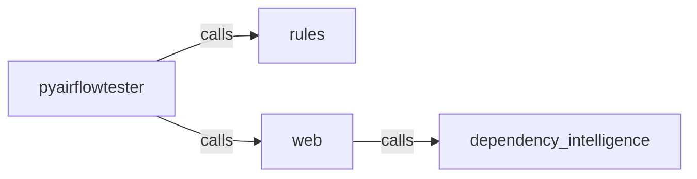

_Generated by CodeAtlas._

## Details

Owns 54 symbols across 7 file(s).

### dependency_intelligence

Owns 207 symbols across 11 file(s).

**Related Classes/Methods:** _None_

**Source Files:**

- `python/pyairflowtester/dependency_intelligence/analytics.py`
  - `python.pyairflowtester.dependency_intelligence.analytics.OwnershipAnalysis`
  - `python.pyairflowtester.dependency_intelligence.analytics.OwnershipAnalyzer`
  - `python.pyairflowtester.dependency_intelligence.analytics.OwnershipAnalyzer.__init__`
  - `python.pyairflowtester.dependency_intelligence.analytics.OwnershipAnalyzer._calculate_team_risk`
  - `python.pyairflowtester.dependency_intelligence.analytics.OwnershipAnalyzer.analyze_all_owners`
  - `python.pyairflowtester.dependency_intelligence.analytics.OwnershipAnalyzer.analyze_owner`
  - `python.pyairflowtester.dependency_intelligence.analytics.OwnershipAnalyzer.find_critical_ownership_gaps`
  - `python.pyairflowtester.dependency_intelligence.analytics.SLAValidation`
  - `python.pyairflowtester.dependency_intelligence.analytics.SLAValidator`
  - `python.pyairflowtester.dependency_intelligence.analytics.SLAValidator.__init__`
  - `python.pyairflowtester.dependency_intelligence.analytics.SLAValidator._is_compliant`
  - `python.pyairflowtester.dependency_intelligence.analytics.SLAValidator.get_missing_slas`
  - `python.pyairflowtester.dependency_intelligence.analytics.SLAValidator.get_sla_violations`
  - `python.pyairflowtester.dependency_intelligence.analytics.SLAValidator.record_performance`
  - `python.pyairflowtester.dependency_intelligence.analytics.SLAValidator.set_sla`
  - `python.pyairflowtester.dependency_intelligence.analytics.SLAValidator.validate_all`
  - `python.pyairflowtester.dependency_intelligence.analytics.SLAValidator.validate_node`
  - `python.pyairflowtester.dependency_intelligence.analytics.SchemaEvolution`
  - `python.pyairflowtester.dependency_intelligence.analytics.SchemaEvolutionTracker`
  - `python.pyairflowtester.dependency_intelligence.analytics.SchemaEvolutionTracker.__init__`
  - `python.pyairflowtester.dependency_intelligence.analytics.SchemaEvolutionTracker.add_schema_change`
  - `python.pyairflowtester.dependency_intelligence.analytics.SchemaEvolutionTracker.detect_breaking_changes`
  - `python.pyairflowtester.dependency_intelligence.analytics.SchemaEvolutionTracker.get_evolution_timeline`
  - `python.pyairflowtester.dependency_intelligence.analytics.TestCoverageAnalysis`
  - `python.pyairflowtester.dependency_intelligence.analytics.TestCoverageAnalyzer`
  - `python.pyairflowtester.dependency_intelligence.analytics.TestCoverageAnalyzer.__init__`
  - `python.pyairflowtester.dependency_intelligence.analytics.TestCoverageAnalyzer.analyze_all`
  - `python.pyairflowtester.dependency_intelligence.analytics.TestCoverageAnalyzer.analyze_coverage`
  - `python.pyairflowtester.dependency_intelligence.analytics.TestCoverageAnalyzer.assign_tests`
  - `python.pyairflowtester.dependency_intelligence.analytics.TestCoverageAnalyzer.get_critical_test_gaps`
  - `python.pyairflowtester.dependency_intelligence.analytics.TestCoverageAnalyzer.get_poorly_tested_nodes`
- `python/pyairflowtester/dependency_intelligence/analyzers.py`
  - `python.pyairflowtester.dependency_intelligence.analyzers.BlastRadiusEngine`
  - `python.pyairflowtester.dependency_intelligence.analyzers.BlastRadiusEngine.__init__`
  - `python.pyairflowtester.dependency_intelligence.analyzers.BlastRadiusEngine._assess_risk_level`
  - `python.pyairflowtester.dependency_intelligence.analyzers.BlastRadiusEngine._calculate_blast_depth`
  - `python.pyairflowtester.dependency_intelligence.analyzers.BlastRadiusEngine._calculate_severity_distribution`
  - `python.pyairflowtester.dependency_intelligence.analyzers.BlastRadiusEngine._is_deployable`
  - `python.pyairflowtester.dependency_intelligence.analyzers.BlastRadiusEngine.analyze`
  - `python.pyairflowtester.dependency_intelligence.analyzers.DriftDetectionEngine`
  - `python.pyairflowtester.dependency_intelligence.analyzers.DriftDetectionEngine.__init__`
  - `python.pyairflowtester.dependency_intelligence.analyzers.DriftDetectionEngine.detect_drift`
  - `python.pyairflowtester.dependency_intelligence.analyzers.ImpactAnalysisEngine`
  - `python.pyairflowtester.dependency_intelligence.analyzers.ImpactAnalysisEngine.__init__`
  - `python.pyairflowtester.dependency_intelligence.analyzers.ImpactAnalysisEngine._calculate_impact_score`
  - `python.pyairflowtester.dependency_intelligence.analyzers.ImpactAnalysisEngine._calculate_max_depth`
  - `python.pyairflowtester.dependency_intelligence.analyzers.ImpactAnalysisEngine._group_by_severity`
  - `python.pyairflowtester.dependency_intelligence.analyzers.ImpactAnalysisEngine._group_by_type`
  - `python.pyairflowtester.dependency_intelligence.analyzers.ImpactAnalysisEngine.analyze`
  - `python.pyairflowtester.dependency_intelligence.analyzers.RiskScoringEngine`
  - `python.pyairflowtester.dependency_intelligence.analyzers.RiskScoringEngine.__init__`
  - `python.pyairflowtester.dependency_intelligence.analyzers.RiskScoringEngine._score_to_severity`
  - `python.pyairflowtester.dependency_intelligence.analyzers.RiskScoringEngine.score_all_nodes`
  - `python.pyairflowtester.dependency_intelligence.analyzers.RiskScoringEngine.score_node`
- `python/pyairflowtester/dependency_intelligence/cache.py`
  - `python.pyairflowtester.dependency_intelligence.cache.CacheStats`
  - `python.pyairflowtester.dependency_intelligence.cache.CacheStats.hit_rate`
  - `python.pyairflowtester.dependency_intelligence.cache.InMemoryCache`
  - `python.pyairflowtester.dependency_intelligence.cache.InMemoryCache.__init__`
  - `python.pyairflowtester.dependency_intelligence.cache.InMemoryCache.clear`
  - `python.pyairflowtester.dependency_intelligence.cache.InMemoryCache.delete`
  - `python.pyairflowtester.dependency_intelligence.cache.InMemoryCache.delete_prefix`
  - `python.pyairflowtester.dependency_intelligence.cache.InMemoryCache.get`
  - `python.pyairflowtester.dependency_intelligence.cache.InMemoryCache.set`
  - `python.pyairflowtester.dependency_intelligence.cache.SqliteCache`
  - `python.pyairflowtester.dependency_intelligence.cache.SqliteCache.__init__`
  - `python.pyairflowtester.dependency_intelligence.cache.SqliteCache.clear`
  - `python.pyairflowtester.dependency_intelligence.cache.SqliteCache.close`
  - `python.pyairflowtester.dependency_intelligence.cache.SqliteCache.delete`
  - `python.pyairflowtester.dependency_intelligence.cache.SqliteCache.delete_prefix`
  - `python.pyairflowtester.dependency_intelligence.cache.SqliteCache.get`
  - `python.pyairflowtester.dependency_intelligence.cache.SqliteCache.set`
  - `python.pyairflowtester.dependency_intelligence.cache.TieredCache`
  - `python.pyairflowtester.dependency_intelligence.cache.TieredCache.__init__`
  - `python.pyairflowtester.dependency_intelligence.cache.TieredCache.emit`
  - `python.pyairflowtester.dependency_intelligence.cache.TieredCache.get`
  - `python.pyairflowtester.dependency_intelligence.cache.TieredCache.invalidate`
  - `python.pyairflowtester.dependency_intelligence.cache.TieredCache.invalidate_prefix`
  - `python.pyairflowtester.dependency_intelligence.cache.TieredCache.register_invalidation_rule`
  - `python.pyairflowtester.dependency_intelligence.cache.TieredCache.set`
- `python/pyairflowtester/dependency_intelligence/cli.py`
  - `python.pyairflowtester.dependency_intelligence.cli.blast_radius`
  - `python.pyairflowtester.dependency_intelligence.cli.build`
  - `python.pyairflowtester.dependency_intelligence.cli.dependency_cli`
  - `python.pyairflowtester.dependency_intelligence.cli.detect_cycles`
  - `python.pyairflowtester.dependency_intelligence.cli.detect_orphans`
  - `python.pyairflowtester.dependency_intelligence.cli.impact`
  - `python.pyairflowtester.dependency_intelligence.cli.lineage`
  - `python.pyairflowtester.dependency_intelligence.cli.register_dependency_cli`
  - `python.pyairflowtester.dependency_intelligence.cli.risk_score`
- `python/pyairflowtester/dependency_intelligence/graph.py`
  - `python.pyairflowtester.dependency_intelligence.graph.DependencyGraphEngine`
  - `python.pyairflowtester.dependency_intelligence.graph.DependencyGraphEngine.__init__`
  - `python.pyairflowtester.dependency_intelligence.graph.DependencyGraphEngine._graph_content_hash`
  - `python.pyairflowtester.dependency_intelligence.graph.DependencyGraphEngine.detect_cycles`
  - `python.pyairflowtester.dependency_intelligence.graph.DependencyGraphEngine.detect_cycles.dfs`
  - `python.pyairflowtester.dependency_intelligence.graph.DependencyGraphEngine.detect_disconnected_components`
  - `python.pyairflowtester.dependency_intelligence.graph.DependencyGraphEngine.detect_disconnected_components.dfs`
  - `python.pyairflowtester.dependency_intelligence.graph.DependencyGraphEngine.detect_orphans`
  - `python.pyairflowtester.dependency_intelligence.graph.DependencyGraphEngine.filter_by_owner`
  - `python.pyairflowtester.dependency_intelligence.graph.DependencyGraphEngine.filter_by_type`
  - `python.pyairflowtester.dependency_intelligence.graph.DependencyGraphEngine.get_critical_path`
  - `python.pyairflowtester.dependency_intelligence.graph.DependencyGraphEngine.get_critical_path.dfs`
  - `python.pyairflowtester.dependency_intelligence.graph.DependencyGraphEngine.get_downstream_nodes`
  - `python.pyairflowtester.dependency_intelligence.graph.DependencyGraphEngine.get_node_centrality`
  - `python.pyairflowtester.dependency_intelligence.graph.DependencyGraphEngine.get_path`
  - `python.pyairflowtester.dependency_intelligence.graph.DependencyGraphEngine.get_reach`
  - `python.pyairflowtester.dependency_intelligence.graph.DependencyGraphEngine.get_stats`
  - `python.pyairflowtester.dependency_intelligence.graph.DependencyGraphEngine.get_strongly_connected_components`
  - `python.pyairflowtester.dependency_intelligence.graph.DependencyGraphEngine.get_strongly_connected_components.strongconnect`
  - `python.pyairflowtester.dependency_intelligence.graph.DependencyGraphEngine.get_upstream_nodes`
  - `python.pyairflowtester.dependency_intelligence.graph.DependencyGraphEngine.has_cycle`
  - `python.pyairflowtester.dependency_intelligence.graph.DependencyGraphEngine.invalidate_cache`
- `python/pyairflowtester/dependency_intelligence/intelligence.py`
  - `python.pyairflowtester.dependency_intelligence.intelligence.AnomalyDetection`
  - `python.pyairflowtester.dependency_intelligence.intelligence.AnomalyDetector`
  - `python.pyairflowtester.dependency_intelligence.intelligence.AnomalyDetector.__init__`
  - `python.pyairflowtester.dependency_intelligence.intelligence.AnomalyDetector.detect_all_anomalies`
  - `python.pyairflowtester.dependency_intelligence.intelligence.FailurePrediction`
  - `python.pyairflowtester.dependency_intelligence.intelligence.FailurePredictionEngine`
  - `python.pyairflowtester.dependency_intelligence.intelligence.FailurePredictionEngine.__init__`
  - `python.pyairflowtester.dependency_intelligence.intelligence.FailurePredictionEngine.get_high_risk_nodes`
  - `python.pyairflowtester.dependency_intelligence.intelligence.FailurePredictionEngine.predict_all_nodes`
  - `python.pyairflowtester.dependency_intelligence.intelligence.FailurePredictionEngine.predict_node_failure`
  - `python.pyairflowtester.dependency_intelligence.intelligence.FailurePredictionEngine.record_failure`
  - `python.pyairflowtester.dependency_intelligence.intelligence.HealthScore`
  - `python.pyairflowtester.dependency_intelligence.intelligence.HealthScoreCalculator`
  - `python.pyairflowtester.dependency_intelligence.intelligence.HealthScoreCalculator.__init__`
  - `python.pyairflowtester.dependency_intelligence.intelligence.HealthScoreCalculator._calculate_connectivity_score`
  - `python.pyairflowtester.dependency_intelligence.intelligence.HealthScoreCalculator._calculate_coverage_score`
  - `python.pyairflowtester.dependency_intelligence.intelligence.HealthScoreCalculator._calculate_ownership_score`
  - `python.pyairflowtester.dependency_intelligence.intelligence.HealthScoreCalculator._calculate_sla_score`
  - `python.pyairflowtester.dependency_intelligence.intelligence.HealthScoreCalculator._calculate_test_score`
  - `python.pyairflowtester.dependency_intelligence.intelligence.HealthScoreCalculator._count_issues`
  - `python.pyairflowtester.dependency_intelligence.intelligence.HealthScoreCalculator.calculate_health_score`
  - `python.pyairflowtester.dependency_intelligence.intelligence.HealthScoreCalculator.get_health_summary`
  - `python.pyairflowtester.dependency_intelligence.intelligence.Recommendation`
  - `python.pyairflowtester.dependency_intelligence.intelligence.RecommendationEngine`
  - `python.pyairflowtester.dependency_intelligence.intelligence.RecommendationEngine.__init__`
  - `python.pyairflowtester.dependency_intelligence.intelligence.RecommendationEngine.generate_recommendations`
  - `python.pyairflowtester.dependency_intelligence.intelligence.RecommendationEngine.get_top_recommendations`
- `python/pyairflowtester/dependency_intelligence/models.py`
  - `python.pyairflowtester.dependency_intelligence.models.BlastRadiusResult`
  - `python.pyairflowtester.dependency_intelligence.models.DependencyGraph`
  - `python.pyairflowtester.dependency_intelligence.models.DependencyGraph.add_edge`
  - `python.pyairflowtester.dependency_intelligence.models.DependencyGraph.add_node`
  - `python.pyairflowtester.dependency_intelligence.models.DependencyGraph.get_critical_nodes`
  - `python.pyairflowtester.dependency_intelligence.models.DependencyGraph.get_edges_from`
  - `python.pyairflowtester.dependency_intelligence.models.DependencyGraph.get_edges_to`
  - `python.pyairflowtester.dependency_intelligence.models.DependencyGraph.get_node`
  - `python.pyairflowtester.dependency_intelligence.models.DependencyGraph.get_node_count_by_type`
  - `python.pyairflowtester.dependency_intelligence.models.DependencyGraph.stats`
  - `python.pyairflowtester.dependency_intelligence.models.DriftDetectionResult`
  - `python.pyairflowtester.dependency_intelligence.models.Edge`
  - `python.pyairflowtester.dependency_intelligence.models.Edge.__eq__`
  - `python.pyairflowtester.dependency_intelligence.models.Edge.__hash__`
  - `python.pyairflowtester.dependency_intelligence.models.ImpactResult`
  - `python.pyairflowtester.dependency_intelligence.models.Node`
  - `python.pyairflowtester.dependency_intelligence.models.Node.__eq__`
  - `python.pyairflowtester.dependency_intelligence.models.Node.__hash__`
  - `python.pyairflowtester.dependency_intelligence.models.NodeSeverity`
  - `python.pyairflowtester.dependency_intelligence.models.NodeType`
  - `python.pyairflowtester.dependency_intelligence.models.RelationshipType`
  - `python.pyairflowtester.dependency_intelligence.models.RiskScoreResult`
- `python/pyairflowtester/dependency_intelligence/observability.py`
  - `python.pyairflowtester.dependency_intelligence.observability.Alert`
  - `python.pyairflowtester.dependency_intelligence.observability.AlertManager`
  - `python.pyairflowtester.dependency_intelligence.observability.AlertManager.__init__`
  - `python.pyairflowtester.dependency_intelligence.observability.AlertManager.check_threshold`
  - `python.pyairflowtester.dependency_intelligence.observability.AlertManager.get_active_alerts`
  - `python.pyairflowtester.dependency_intelligence.observability.AlertManager.get_alerts_for_node`
  - `python.pyairflowtester.dependency_intelligence.observability.AlertManager.resolve_alert`
  - `python.pyairflowtester.dependency_intelligence.observability.AlertManager.set_threshold`
  - `python.pyairflowtester.dependency_intelligence.observability.DashboardBuilder`
  - `python.pyairflowtester.dependency_intelligence.observability.DashboardBuilder.__init__`
  - `python.pyairflowtester.dependency_intelligence.observability.DashboardBuilder._get_slowest_nodes`
  - `python.pyairflowtester.dependency_intelligence.observability.DashboardBuilder._get_top_failing_nodes`
  - `python.pyairflowtester.dependency_intelligence.observability.DashboardBuilder.build_health_dashboard`
  - `python.pyairflowtester.dependency_intelligence.observability.DashboardBuilder.build_node_dashboard`
  - `python.pyairflowtester.dependency_intelligence.observability.EventLogger`
  - `python.pyairflowtester.dependency_intelligence.observability.EventLogger.__init__`
  - `python.pyairflowtester.dependency_intelligence.observability.EventLogger.cleanup_old_events`
  - `python.pyairflowtester.dependency_intelligence.observability.EventLogger.export_events`
  - `python.pyairflowtester.dependency_intelligence.observability.EventLogger.get_average_duration`
  - `python.pyairflowtester.dependency_intelligence.observability.EventLogger.get_events_for_node`
  - `python.pyairflowtester.dependency_intelligence.observability.EventLogger.get_failure_rate`
  - `python.pyairflowtester.dependency_intelligence.observability.EventLogger.log_execution`
  - `python.pyairflowtester.dependency_intelligence.observability.ExecutionEvent`
  - `python.pyairflowtester.dependency_intelligence.observability.Metric`
  - `python.pyairflowtester.dependency_intelligence.observability.MetricType`
  - `python.pyairflowtester.dependency_intelligence.observability.MetricsCollector`
  - `python.pyairflowtester.dependency_intelligence.observability.MetricsCollector.__init__`
  - `python.pyairflowtester.dependency_intelligence.observability.MetricsCollector.calculate_statistics`
  - `python.pyairflowtester.dependency_intelligence.observability.MetricsCollector.cleanup_old_metrics`
  - `python.pyairflowtester.dependency_intelligence.observability.MetricsCollector.get_metrics_for_node`
  - `python.pyairflowtester.dependency_intelligence.observability.MetricsCollector.record_metric`
- `python/pyairflowtester/dependency_intelligence/parsers.py`
  - `python.pyairflowtester.dependency_intelligence.parsers.AirflowDAGParser`
  - `python.pyairflowtester.dependency_intelligence.parsers.AirflowDAGParser.build_graph`
  - `python.pyairflowtester.dependency_intelligence.parsers.AirflowDAGParser.parse_dag_code`
  - `python.pyairflowtester.dependency_intelligence.parsers.AirflowDAGParser.parse_dag_code.DAGVisitor`
  - `python.pyairflowtester.dependency_intelligence.parsers.AirflowDAGParser.parse_dag_code.DAGVisitor.visit_Call`
  - `python.pyairflowtester.dependency_intelligence.parsers.AirflowDAGParser.parse_dag_file`
  - `python.pyairflowtester.dependency_intelligence.parsers.AirflowDatasetParser`
  - `python.pyairflowtester.dependency_intelligence.parsers.AirflowDatasetParser.build_dataset_graph`
  - `python.pyairflowtester.dependency_intelligence.parsers.AirflowDatasetParser.parse_dataset_connections`
  - `python.pyairflowtester.dependency_intelligence.parsers.AirflowDatasetParser.parse_dataset_connections.DatasetVisitor`
  - `python.pyairflowtester.dependency_intelligence.parsers.AirflowDatasetParser.parse_dataset_connections.DatasetVisitor.visit_Call`
  - `python.pyairflowtester.dependency_intelligence.parsers.UnifiedGraphBuilder`
  - `python.pyairflowtester.dependency_intelligence.parsers.UnifiedGraphBuilder.build_unified_graph`
  - `python.pyairflowtester.dependency_intelligence.parsers.dbtManifestParser`
  - `python.pyairflowtester.dependency_intelligence.parsers.dbtManifestParser.parse_manifest`
  - `python.pyairflowtester.dependency_intelligence.parsers.dbtManifestParser.parse_model_node`
- `python/pyairflowtester/dependency_intelligence/runtime_import.py`
  - `python.pyairflowtester.dependency_intelligence.runtime_import.parse_dag_file_with_fallback`
  - `python.pyairflowtester.dependency_intelligence.runtime_import.parse_dag_via_runtime_import`

### rules

Owns 115 symbols across 5 file(s).

**Related Classes/Methods:** _None_

**Source Files:**

- `python/pyairflowtester/rules/__init__.py`
  - `python.pyairflowtester.rules.__init__.get_all_rules`
- `python/pyairflowtester/rules/config.py`
  - `python.pyairflowtester.rules.config.AirflowCfgPoolConfigurationRule`
  - `python.pyairflowtester.rules.config.AirflowCfgPoolConfigurationRule.__init__`
  - `python.pyairflowtester.rules.config.AirflowCfgPoolConfigurationRule.evaluate`
  - `python.pyairflowtester.rules.config.BaseRule`
  - `python.pyairflowtester.rules.config.BaseRule.__init__`
  - `python.pyairflowtester.rules.config.BaseRule.evaluate`
  - `python.pyairflowtester.rules.config.ConcurrencyConfigurationRule`
  - `python.pyairflowtester.rules.config.ConcurrencyConfigurationRule.__init__`
  - `python.pyairflowtester.rules.config.ConcurrencyConfigurationRule.evaluate`
  - `python.pyairflowtester.rules.config.DAGFolderConfigurationRule`
  - `python.pyairflowtester.rules.config.DAGFolderConfigurationRule.__init__`
  - `python.pyairflowtester.rules.config.DAGFolderConfigurationRule.evaluate`
  - `python.pyairflowtester.rules.config.DatabaseBackupRule`
  - `python.pyairflowtester.rules.config.DatabaseBackupRule.__init__`
  - `python.pyairflowtester.rules.config.DatabaseBackupRule.evaluate`
  - `python.pyairflowtester.rules.config.EncryptionConfigurationRule`
  - `python.pyairflowtester.rules.config.EncryptionConfigurationRule.__init__`
  - `python.pyairflowtester.rules.config.EncryptionConfigurationRule.evaluate`
  - `python.pyairflowtester.rules.config.ExecutorConfigurationRule`
  - `python.pyairflowtester.rules.config.ExecutorConfigurationRule.__init__`
  - `python.pyairflowtester.rules.config.ExecutorConfigurationRule.evaluate`
  - `python.pyairflowtester.rules.config.LogRetentionRule`
  - `python.pyairflowtester.rules.config.LogRetentionRule.__init__`
  - `python.pyairflowtester.rules.config.LogRetentionRule.evaluate`
  - `python.pyairflowtester.rules.config.LogStorageRule`
  - `python.pyairflowtester.rules.config.LogStorageRule.__init__`
  - `python.pyairflowtester.rules.config.LogStorageRule.evaluate`
  - `python.pyairflowtester.rules.config.MaxActiveRunsRule`
  - `python.pyairflowtester.rules.config.MaxActiveRunsRule.__init__`
  - `python.pyairflowtester.rules.config.MaxActiveRunsRule.evaluate`
  - `python.pyairflowtester.rules.config.QueueConfigurationRule`
  - `python.pyairflowtester.rules.config.QueueConfigurationRule.__init__`
  - `python.pyairflowtester.rules.config.QueueConfigurationRule.evaluate`
  - `python.pyairflowtester.rules.config.RBACConfigurationRule`
  - `python.pyairflowtester.rules.config.RBACConfigurationRule.__init__`
  - `python.pyairflowtester.rules.config.RBACConfigurationRule.evaluate`
  - `python.pyairflowtester.rules.config.SchedulerConfigurationRule`
  - `python.pyairflowtester.rules.config.SchedulerConfigurationRule.__init__`
  - `python.pyairflowtester.rules.config.SchedulerConfigurationRule.evaluate`
  - `python.pyairflowtester.rules.config.TLSConfigurationRule`
  - `python.pyairflowtester.rules.config.TLSConfigurationRule.__init__`
  - `python.pyairflowtester.rules.config.TLSConfigurationRule.evaluate`
  - `python.pyairflowtester.rules.config.WorkerConfigurationRule`
  - `python.pyairflowtester.rules.config.WorkerConfigurationRule.__init__`
  - `python.pyairflowtester.rules.config.WorkerConfigurationRule.evaluate`
  - `python.pyairflowtester.rules.config.XComConfigurationRule`
  - `python.pyairflowtester.rules.config.XComConfigurationRule.__init__`
  - `python.pyairflowtester.rules.config.XComConfigurationRule.evaluate`
- `python/pyairflowtester/rules/dag.py`
  - `python.pyairflowtester.rules.dag.BaseRule`
  - `python.pyairflowtester.rules.dag.BaseRule.__init__`
  - `python.pyairflowtester.rules.dag.BaseRule.evaluate`
  - `python.pyairflowtester.rules.dag.CircularDependencyRule`
  - `python.pyairflowtester.rules.dag.CircularDependencyRule.__init__`
  - `python.pyairflowtester.rules.dag.CircularDependencyRule._extract_edges`
  - `python.pyairflowtester.rules.dag.CircularDependencyRule._has_cycle`
  - `python.pyairflowtester.rules.dag.CircularDependencyRule._has_cycle.dfs`
  - `python.pyairflowtester.rules.dag.CircularDependencyRule.evaluate`
  - `python.pyairflowtester.rules.dag.ExpensiveImportsRule`
  - `python.pyairflowtester.rules.dag.ExpensiveImportsRule.__init__`
  - `python.pyairflowtester.rules.dag.ExpensiveImportsRule.evaluate`
  - `python.pyairflowtester.rules.dag.MissingSLARule`
  - `python.pyairflowtester.rules.dag.MissingSLARule.__init__`
  - `python.pyairflowtester.rules.dag.MissingSLARule.evaluate`
  - `python.pyairflowtester.rules.dag.ParseTimeRule`
  - `python.pyairflowtester.rules.dag.ParseTimeRule.__init__`
  - `python.pyairflowtester.rules.dag.ParseTimeRule.evaluate`
- `python/pyairflowtester/rules/dag_advanced.py`
  - `python.pyairflowtester.rules.dag_advanced.AlertingConfigurationRule`
  - `python.pyairflowtester.rules.dag_advanced.AlertingConfigurationRule.__init__`
  - `python.pyairflowtester.rules.dag_advanced.AlertingConfigurationRule.evaluate`
  - `python.pyairflowtester.rules.dag_advanced.BaseRule`
  - `python.pyairflowtester.rules.dag_advanced.BaseRule.__init__`
  - `python.pyairflowtester.rules.dag_advanced.BaseRule.evaluate`
  - `python.pyairflowtester.rules.dag_advanced.BranchComplexityRule`
  - `python.pyairflowtester.rules.dag_advanced.BranchComplexityRule.__init__`
  - `python.pyairflowtester.rules.dag_advanced.BranchComplexityRule.evaluate`
  - `python.pyairflowtester.rules.dag_advanced.CatchupConfigRule`
  - `python.pyairflowtester.rules.dag_advanced.CatchupConfigRule.__init__`
  - `python.pyairflowtester.rules.dag_advanced.CatchupConfigRule.evaluate`
  - `python.pyairflowtester.rules.dag_advanced.DocumentationRule`
  - `python.pyairflowtester.rules.dag_advanced.DocumentationRule.__init__`
  - `python.pyairflowtester.rules.dag_advanced.DocumentationRule.evaluate`
  - `python.pyairflowtester.rules.dag_advanced.HardcodedConnectionRule`
  - `python.pyairflowtester.rules.dag_advanced.HardcodedConnectionRule.__init__`
  - `python.pyairflowtester.rules.dag_advanced.HardcodedConnectionRule.evaluate`
  - `python.pyairflowtester.rules.dag_advanced.OperatorDeprecationRule`
  - `python.pyairflowtester.rules.dag_advanced.OperatorDeprecationRule.__init__`
  - `python.pyairflowtester.rules.dag_advanced.OperatorDeprecationRule.evaluate`
  - `python.pyairflowtester.rules.dag_advanced.RetryConfigurationRule`
  - `python.pyairflowtester.rules.dag_advanced.RetryConfigurationRule.__init__`
  - `python.pyairflowtester.rules.dag_advanced.RetryConfigurationRule.evaluate`
  - `python.pyairflowtester.rules.dag_advanced.SecretsInCodeRule`
  - `python.pyairflowtester.rules.dag_advanced.SecretsInCodeRule.__init__`
  - `python.pyairflowtester.rules.dag_advanced.SecretsInCodeRule.evaluate`
  - `python.pyairflowtester.rules.dag_advanced.SensorTimeoutRule`
  - `python.pyairflowtester.rules.dag_advanced.SensorTimeoutRule.__init__`
  - `python.pyairflowtester.rules.dag_advanced.SensorTimeoutRule.evaluate`
  - `python.pyairflowtester.rules.dag_advanced.SourceCodePoolConfigurationRule`
  - `python.pyairflowtester.rules.dag_advanced.SourceCodePoolConfigurationRule.__init__`
  - `python.pyairflowtester.rules.dag_advanced.SourceCodePoolConfigurationRule.evaluate`
  - `python.pyairflowtester.rules.dag_advanced.TaskCountRule`
  - `python.pyairflowtester.rules.dag_advanced.TaskCountRule.__init__`
  - `python.pyairflowtester.rules.dag_advanced.TaskCountRule.evaluate`
- `python/pyairflowtester/rules/dbt.py`
  - `python.pyairflowtester.rules.dbt.BaseRule`
  - `python.pyairflowtester.rules.dbt.BaseRule.__init__`
  - `python.pyairflowtester.rules.dbt.BaseRule.evaluate`
  - `python.pyairflowtester.rules.dbt.MissingTestsRule`
  - `python.pyairflowtester.rules.dbt.MissingTestsRule.__init__`
  - `python.pyairflowtester.rules.dbt.MissingTestsRule.evaluate`
  - `python.pyairflowtester.rules.dbt.RedundantTestsRule`
  - `python.pyairflowtester.rules.dbt.RedundantTestsRule.__init__`
  - `python.pyairflowtester.rules.dbt.RedundantTestsRule.evaluate`
  - `python.pyairflowtester.rules.dbt.UntestedModelRule`
  - `python.pyairflowtester.rules.dbt.UntestedModelRule.__init__`
  - `python.pyairflowtester.rules.dbt.UntestedModelRule.evaluate`

### web

Owns 6 symbols across 2 file(s).

**Related Classes/Methods:** _None_

**Source Files:**

- `python/pyairflowtester/web/app.py`
  - `python.pyairflowtester.web.app._render_value`
  - `python.pyairflowtester.web.app.build_app_from_sources`
  - `python.pyairflowtester.web.app.create_app`
  - `python.pyairflowtester.web.app.create_app.health_dashboard`
  - `python.pyairflowtester.web.app.create_app.list_nodes`
  - `python.pyairflowtester.web.app.create_app.node_dashboard`
