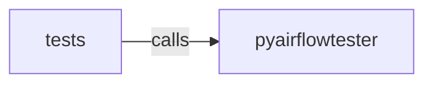

_Generated by CodeAtlas._

## Details

Owns 0 symbols across 0 file(s).

### pyairflowtester

Owns 54 symbols across 7 file(s).

**Related Classes/Methods:** _None_

**Source Files:**

- `python/pyairflowtester/analyzer.py`
  - `python.pyairflowtester.analyzer.Analyzer`
  - `python.pyairflowtester.analyzer.Analyzer.__init__`
  - `python.pyairflowtester.analyzer.Analyzer.analyze_cascade_failures`
  - `python.pyairflowtester.analyzer.Analyzer.analyze_dag_failures`
  - `python.pyairflowtester.analyzer.Analyzer.analyze_task_failures`
  - `python.pyairflowtester.analyzer.Analyzer.calculate_blast_radius`
  - `python.pyairflowtester.analyzer.Analyzer.connect`
  - `python.pyairflowtester.analyzer.Analyzer.detect_flaky_tests`
  - `python.pyairflowtester.analyzer.Analyzer.detect_hotspots`
  - `python.pyairflowtester.analyzer.Analyzer.get_dbt_test_failures`
  - `python.pyairflowtester.analyzer.AnalyzerNotImplementedError`
  - `python.pyairflowtester.analyzer.AnalyzerNotImplementedError.__init__`
- `python/pyairflowtester/cli.py`
  - `python.pyairflowtester.cli._display_violations`
  - `python.pyairflowtester.cli.connect`
  - `python.pyairflowtester.cli.main`
  - `python.pyairflowtester.cli.rules`
  - `python.pyairflowtester.cli.scan`
  - `python.pyairflowtester.cli.score`
  - `python.pyairflowtester.cli.serve`
- `python/pyairflowtester/models.py`
  - `python.pyairflowtester.models.AnalysisContext`
  - `python.pyairflowtester.models.DagDefinition`
  - `python.pyairflowtester.models.DbtModel`
  - `python.pyairflowtester.models.DbtTest`
  - `python.pyairflowtester.models.RiskScorecard`
  - `python.pyairflowtester.models.RiskScorecard.to_dict`
  - `python.pyairflowtester.models.Rule`
  - `python.pyairflowtester.models.RuleViolation`
  - `python.pyairflowtester.models.RuleViolation.to_dict`
- `python/pyairflowtester/report.py`
  - `python.pyairflowtester.report.ReportGenerator`
  - `python.pyairflowtester.report.ReportGenerator._severity_to_level`
  - `python.pyairflowtester.report.ReportGenerator.generate`
  - `python.pyairflowtester.report.ReportGenerator.generate_html`
  - `python.pyairflowtester.report.ReportGenerator.generate_json`
  - `python.pyairflowtester.report.ReportGenerator.generate_markdown`
  - `python.pyairflowtester.report.ReportGenerator.generate_sarif`
- `python/pyairflowtester/scanner.py`
  - `python.pyairflowtester.scanner.Scanner`
  - `python.pyairflowtester.scanner.Scanner.__init__`
  - `python.pyairflowtester.scanner.Scanner._coerce_config_value`
  - `python.pyairflowtester.scanner.Scanner._get_config_rules`
  - `python.pyairflowtester.scanner.Scanner._get_dag_rules`
  - `python.pyairflowtester.scanner.Scanner._get_dbt_rules`
  - `python.pyairflowtester.scanner.Scanner._get_scorer`
  - `python.pyairflowtester.scanner.Scanner._parse_airflow_cfg`
  - `python.pyairflowtester.scanner.Scanner.scan_config`
  - `python.pyairflowtester.scanner.Scanner.scan_dags`
  - `python.pyairflowtester.scanner.Scanner.scan_dbt`
- `python/pyairflowtester/scoring.py`
  - `python.pyairflowtester.scoring.Scorer`
  - `python.pyairflowtester.scoring.Scorer.__init__`
  - `python.pyairflowtester.scoring.Scorer.aggregate_by_severity`
  - `python.pyairflowtester.scoring.Scorer.calculate_health_score`
  - `python.pyairflowtester.scoring.Scorer.calculate_risk_score`
  - `python.pyairflowtester.scoring.Scorer.calculate_trend`
  - `python.pyairflowtester.scoring.Scorer.categorize_risk`
  - `python.pyairflowtester.scoring.Scorer.filter_by_severity`

### tests

Owns 274 symbols across 14 file(s).

**Related Classes/Methods:** _None_

**Source Files:**

- `python/tests/test_cache.py`
  - `python.tests.test_cache.TestInMemoryCache`
  - `python.tests.test_cache.TestInMemoryCache.test_delete_prefix`
  - `python.tests.test_cache.TestInMemoryCache.test_hit_rate`
  - `python.tests.test_cache.TestInMemoryCache.test_lru_eviction`
  - `python.tests.test_cache.TestInMemoryCache.test_miss_returns_none`
  - `python.tests.test_cache.TestInMemoryCache.test_set_and_get`
  - `python.tests.test_cache.TestInMemoryCache.test_ttl_expiry`
  - `python.tests.test_cache.TestSqliteCache`
  - `python.tests.test_cache.TestSqliteCache.test_concurrent_processes_can_share_the_same_file`
  - `python.tests.test_cache.TestSqliteCache.test_delete_prefix`
  - `python.tests.test_cache.TestSqliteCache.test_set_and_get_persists_across_instances`
  - `python.tests.test_cache.TestSqliteCache.test_ttl_expiry`
  - `python.tests.test_cache.TestSqliteCache.test_uses_wal_journal_mode`
  - `python.tests.test_cache.TestTieredCache`
  - `python.tests.test_cache.TestTieredCache.test_emit_with_no_registered_rules_is_a_noop`
  - `python.tests.test_cache.TestTieredCache.test_event_driven_invalidation`
  - `python.tests.test_cache.TestTieredCache.test_invalidate_prefix_clears_both_tiers`
  - `python.tests.test_cache.TestTieredCache.test_read_through_from_l3_populates_l1`
  - `python.tests.test_cache.TestTieredCache.test_set_writes_both_tiers`
  - `python.tests.test_cache.TestTieredCache.test_works_with_only_l1`
- `python/tests/test_dag_advanced_rules.py`
  - `python.tests.test_dag_advanced_rules.TestAlertingConfigurationRule`
  - `python.tests.test_dag_advanced_rules.TestAlertingConfigurationRule.test_production_with_alerts`
  - `python.tests.test_dag_advanced_rules.TestAlertingConfigurationRule.test_production_without_alerts`
  - `python.tests.test_dag_advanced_rules.TestCatchupConfigRule`
  - `python.tests.test_dag_advanced_rules.TestCatchupConfigRule.test_risky_catchup`
  - `python.tests.test_dag_advanced_rules.TestCatchupConfigRule.test_safe_catchup`
  - `python.tests.test_dag_advanced_rules.TestDocumentationRule`
  - `python.tests.test_dag_advanced_rules.TestDocumentationRule.test_missing_description`
  - `python.tests.test_dag_advanced_rules.TestDocumentationRule.test_with_description`
  - `python.tests.test_dag_advanced_rules.TestHardcodedConnectionRule`
  - `python.tests.test_dag_advanced_rules.TestHardcodedConnectionRule.test_hardcoded_connection_string`
  - `python.tests.test_dag_advanced_rules.TestHardcodedConnectionRule.test_hardcoded_host`
  - `python.tests.test_dag_advanced_rules.TestOperatorDeprecationRule`
  - `python.tests.test_dag_advanced_rules.TestOperatorDeprecationRule.test_dummyoperator`
  - `python.tests.test_dag_advanced_rules.TestOperatorDeprecationRule.test_modern_operators`
  - `python.tests.test_dag_advanced_rules.TestOperatorDeprecationRule.test_subdagoperator`
  - `python.tests.test_dag_advanced_rules.TestRetryConfigurationRule`
  - `python.tests.test_dag_advanced_rules.TestRetryConfigurationRule.test_high_retry_count`
  - `python.tests.test_dag_advanced_rules.TestRetryConfigurationRule.test_high_retry_with_backoff`
  - `python.tests.test_dag_advanced_rules.TestSecretsInCodeRule`
  - `python.tests.test_dag_advanced_rules.TestSecretsInCodeRule.test_hardcoded_api_key`
  - `python.tests.test_dag_advanced_rules.TestSecretsInCodeRule.test_hardcoded_password`
  - `python.tests.test_dag_advanced_rules.TestSecretsInCodeRule.test_hardcoded_secret_with_uppercase_variable_name`
  - `python.tests.test_dag_advanced_rules.TestSecretsInCodeRule.test_no_secrets`
  - `python.tests.test_dag_advanced_rules.TestSensorTimeoutRule`
  - `python.tests.test_dag_advanced_rules.TestSensorTimeoutRule.test_high_timeout`
  - `python.tests.test_dag_advanced_rules.TestSensorTimeoutRule.test_reasonable_timeout`
  - `python.tests.test_dag_advanced_rules.TestTaskCountRule`
  - `python.tests.test_dag_advanced_rules.TestTaskCountRule.test_high_task_count`
  - `python.tests.test_dag_advanced_rules.TestTaskCountRule.test_normal_task_count`
- `python/tests/test_dag_rules.py`
  - `python.tests.test_dag_rules.TestCircularDependencyRule`
  - `python.tests.test_dag_rules.TestCircularDependencyRule.test_detects_cycle_via_set_downstream`
  - `python.tests.test_dag_rules.TestCircularDependencyRule.test_detects_cycle_via_set_upstream`
  - `python.tests.test_dag_rules.TestCircularDependencyRule.test_detects_three_node_cycle_via_shift_operator`
  - `python.tests.test_dag_rules.TestCircularDependencyRule.test_detects_two_node_cycle`
  - `python.tests.test_dag_rules.TestCircularDependencyRule.test_does_not_raise`
  - `python.tests.test_dag_rules.TestCircularDependencyRule.test_no_cycle_on_empty_source`
  - `python.tests.test_dag_rules.TestCircularDependencyRule.test_no_cycle_on_linear_chain`
  - `python.tests.test_dag_rules.TestCircularDependencyRule.test_no_false_positive_on_diamond_dependency`
  - `python.tests.test_dag_rules.TestExpensiveImportsRule`
  - `python.tests.test_dag_rules.TestExpensiveImportsRule.test_clean_source_has_no_violations`
  - `python.tests.test_dag_rules.TestExpensiveImportsRule.test_does_not_false_positive_on_similarly_named_packages`
  - `python.tests.test_dag_rules.TestExpensiveImportsRule.test_flags_tensorflow_import`
  - `python.tests.test_dag_rules.TestExpensiveImportsRule.test_still_flags_real_module_with_submodule_import`
  - `python.tests.test_dag_rules.TestMissingSLARule`
  - `python.tests.test_dag_rules.TestMissingSLARule.test_flags_production_dag_without_sla`
  - `python.tests.test_dag_rules.TestMissingSLARule.test_ignores_non_production_dag`
  - `python.tests.test_dag_rules.TestParseTimeRule`
  - `python.tests.test_dag_rules.TestParseTimeRule.test_clean_source_has_no_violations`
  - `python.tests.test_dag_rules.TestParseTimeRule.test_flags_loop_based_dag_generation`
- `python/tests/test_dependency_analytics.py`
  - `python.tests.test_dependency_analytics.TestOwnershipAnalyzer`
  - `python.tests.test_dependency_analytics.TestOwnershipAnalyzer.test_analyze_all_owners`
  - `python.tests.test_dependency_analytics.TestOwnershipAnalyzer.test_analyze_owner`
  - `python.tests.test_dependency_analytics.TestOwnershipAnalyzer.test_critical_ownership_gaps`
  - `python.tests.test_dependency_analytics.TestOwnershipAnalyzer.test_cross_team_edges`
  - `python.tests.test_dependency_analytics.TestOwnershipAnalyzer.test_team_risk_score`
  - `python.tests.test_dependency_analytics.TestSLAValidator`
  - `python.tests.test_dependency_analytics.TestSLAValidator.test_get_missing_slas`
  - `python.tests.test_dependency_analytics.TestSLAValidator.test_get_sla_violations`
  - `python.tests.test_dependency_analytics.TestSLAValidator.test_set_sla`
  - `python.tests.test_dependency_analytics.TestSLAValidator.test_validate_compliant_node`
  - `python.tests.test_dependency_analytics.TestSLAValidator.test_validate_violated_node`
  - `python.tests.test_dependency_analytics.TestSchemaEvolutionTracker`
  - `python.tests.test_dependency_analytics.TestSchemaEvolutionTracker.test_add_schema_change`
  - `python.tests.test_dependency_analytics.TestSchemaEvolutionTracker.test_detect_breaking_changes`
  - `python.tests.test_dependency_analytics.TestSchemaEvolutionTracker.test_get_evolution_timeline`
  - `python.tests.test_dependency_analytics.TestTestCoverageAnalyzer`
  - `python.tests.test_dependency_analytics.TestTestCoverageAnalyzer.test_analyze_coverage`
  - `python.tests.test_dependency_analytics.TestTestCoverageAnalyzer.test_assign_tests`
  - `python.tests.test_dependency_analytics.TestTestCoverageAnalyzer.test_coverage_status`
  - `python.tests.test_dependency_analytics.TestTestCoverageAnalyzer.test_get_critical_test_gaps`
  - `python.tests.test_dependency_analytics.TestTestCoverageAnalyzer.test_get_poorly_tested_nodes`
  - `python.tests.test_dependency_analytics.test_graph`
- `python/tests/test_dependency_analyzers.py`
  - `python.tests.test_dependency_analyzers.TestAnalyzerIntegration`
  - `python.tests.test_dependency_analyzers.TestAnalyzerIntegration.test_blast_radius_to_risk_scoring`
  - `python.tests.test_dependency_analyzers.TestAnalyzerIntegration.test_impact_to_blast_radius`
  - `python.tests.test_dependency_analyzers.TestBlastRadius`
  - `python.tests.test_dependency_analyzers.TestBlastRadius.test_deployability`
  - `python.tests.test_dependency_analyzers.TestBlastRadius.test_multi_node_blast`
  - `python.tests.test_dependency_analyzers.TestBlastRadius.test_risk_assessment`
  - `python.tests.test_dependency_analyzers.TestBlastRadius.test_severity_distribution`
  - `python.tests.test_dependency_analyzers.TestBlastRadius.test_single_node_blast`
  - `python.tests.test_dependency_analyzers.TestDriftDetection`
  - `python.tests.test_dependency_analyzers.TestDriftDetection.test_drift_affected_nodes`
  - `python.tests.test_dependency_analyzers.TestDriftDetection.test_drift_severity`
  - `python.tests.test_dependency_analyzers.TestDriftDetection.test_edge_addition`
  - `python.tests.test_dependency_analyzers.TestDriftDetection.test_no_drift`
  - `python.tests.test_dependency_analyzers.TestDriftDetection.test_node_addition`
  - `python.tests.test_dependency_analyzers.TestDriftDetection.test_node_removal`
  - `python.tests.test_dependency_analyzers.TestImpactAnalysis`
  - `python.tests.test_dependency_analyzers.TestImpactAnalysis.test_impact_critical_node`
  - `python.tests.test_dependency_analyzers.TestImpactAnalysis.test_impact_grouping`
  - `python.tests.test_dependency_analyzers.TestImpactAnalysis.test_impact_nonexistent_node`
  - `python.tests.test_dependency_analyzers.TestImpactAnalysis.test_impact_with_depth`
  - `python.tests.test_dependency_analyzers.TestRiskScoring`
  - `python.tests.test_dependency_analyzers.TestRiskScoring.test_critical_node_high_score`
  - `python.tests.test_dependency_analyzers.TestRiskScoring.test_score_all_nodes`
  - `python.tests.test_dependency_analyzers.TestRiskScoring.test_score_components`
  - `python.tests.test_dependency_analyzers.TestRiskScoring.test_score_factors`
  - `python.tests.test_dependency_analyzers.TestRiskScoring.test_score_node`
  - `python.tests.test_dependency_analyzers.test_graph`
- `python/tests/test_dependency_cli.py`
  - `python.tests.test_dependency_cli.TestBuildDatasetsOption`
  - `python.tests.test_dependency_cli.TestBuildDatasetsOption.test_datasets_option_is_not_silently_discarded`
- `python/tests/test_dependency_graph.py`
  - `python.tests.test_dependency_graph.TestCaching`
  - `python.tests.test_dependency_graph.TestCaching.test_cache_invalidation`
  - `python.tests.test_dependency_graph.TestConnectivityAnalysis`
  - `python.tests.test_dependency_graph.TestConnectivityAnalysis.test_centrality`
  - `python.tests.test_dependency_graph.TestConnectivityAnalysis.test_connected_components`
  - `python.tests.test_dependency_graph.TestConnectivityAnalysis.test_critical_path`
  - `python.tests.test_dependency_graph.TestCycleDetection`
  - `python.tests.test_dependency_graph.TestCycleDetection.test_multiple_cycles`
  - `python.tests.test_dependency_graph.TestCycleDetection.test_no_cycles`
  - `python.tests.test_dependency_graph.TestCycleDetection.test_simple_cycle`
  - `python.tests.test_dependency_graph.TestGraphStats`
  - `python.tests.test_dependency_graph.TestGraphStats.test_node_owner_filtering`
  - `python.tests.test_dependency_graph.TestGraphStats.test_node_type_filtering`
  - `python.tests.test_dependency_graph.TestGraphStats.test_stats`
  - `python.tests.test_dependency_graph.TestOrphanDetection`
  - `python.tests.test_dependency_graph.TestOrphanDetection.test_isolated_node`
  - `python.tests.test_dependency_graph.TestOrphanDetection.test_orphan_detection`
  - `python.tests.test_dependency_graph.TestTieredCacheIntegration`
  - `python.tests.test_dependency_graph.TestTieredCacheIntegration.test_changed_graph_gets_a_different_cache_key_not_stale_results`
  - `python.tests.test_dependency_graph.TestTieredCacheIntegration.test_detect_cycles_populates_and_reuses_cache`
  - `python.tests.test_dependency_graph.TestTieredCacheIntegration.test_engine_without_cache_still_works`
  - `python.tests.test_dependency_graph.TestTieredCacheIntegration.test_second_engine_instance_reuses_first_ones_cached_result`
  - `python.tests.test_dependency_graph.TestTieredCacheIntegration.test_sqlite_backed_cache_persists_across_process_boundary_simulation`
  - `python.tests.test_dependency_graph.TestTieredCacheIntegration.test_strongly_connected_components_cache_round_trips_as_sets`
  - `python.tests.test_dependency_graph.TestTraversal`
  - `python.tests.test_dependency_graph.TestTraversal.test_downstream_traversal`
  - `python.tests.test_dependency_graph.TestTraversal.test_nonexistent_node`
  - `python.tests.test_dependency_graph.TestTraversal.test_path_finding`
  - `python.tests.test_dependency_graph.TestTraversal.test_reachability`
  - `python.tests.test_dependency_graph.TestTraversal.test_upstream_traversal`
  - `python.tests.test_dependency_graph.TestTraversal.test_upstream_with_depth`
  - `python.tests.test_dependency_graph.cyclic_graph`
  - `python.tests.test_dependency_graph.simple_graph`
- `python/tests/test_dependency_intelligence_phase2.py`
  - `python.tests.test_dependency_intelligence_phase2.TestAlertManager`
  - `python.tests.test_dependency_intelligence_phase2.TestAlertManager.test_check_threshold_critical`
  - `python.tests.test_dependency_intelligence_phase2.TestAlertManager.test_check_threshold_warning`
  - `python.tests.test_dependency_intelligence_phase2.TestAlertManager.test_get_active_alerts`
  - `python.tests.test_dependency_intelligence_phase2.TestAlertManager.test_no_alert_below_threshold`
  - `python.tests.test_dependency_intelligence_phase2.TestAlertManager.test_resolve_alert`
  - `python.tests.test_dependency_intelligence_phase2.TestAlertManager.test_set_threshold`
  - `python.tests.test_dependency_intelligence_phase2.TestAnomalyDetector`
  - `python.tests.test_dependency_intelligence_phase2.TestAnomalyDetector.test_detect_anomalies`
  - `python.tests.test_dependency_intelligence_phase2.TestAnomalyDetector.test_unowned_critical_detection`
  - `python.tests.test_dependency_intelligence_phase2.TestDashboardBuilder`
  - `python.tests.test_dependency_intelligence_phase2.TestDashboardBuilder.test_build_health_dashboard`
  - `python.tests.test_dependency_intelligence_phase2.TestDashboardBuilder.test_build_node_dashboard`
  - `python.tests.test_dependency_intelligence_phase2.TestEventLogger`
  - `python.tests.test_dependency_intelligence_phase2.TestEventLogger.test_average_duration`
  - `python.tests.test_dependency_intelligence_phase2.TestEventLogger.test_failure_rate`
  - `python.tests.test_dependency_intelligence_phase2.TestEventLogger.test_get_events_for_node`
  - `python.tests.test_dependency_intelligence_phase2.TestEventLogger.test_log_execution`
  - `python.tests.test_dependency_intelligence_phase2.TestFailurePredictionEngine`
  - `python.tests.test_dependency_intelligence_phase2.TestFailurePredictionEngine.test_high_risk_nodes`
  - `python.tests.test_dependency_intelligence_phase2.TestFailurePredictionEngine.test_predict_all_nodes`
  - `python.tests.test_dependency_intelligence_phase2.TestFailurePredictionEngine.test_predict_node_failure`
  - `python.tests.test_dependency_intelligence_phase2.TestFailurePredictionEngine.test_record_failure`
  - `python.tests.test_dependency_intelligence_phase2.TestFailurePredictionEngine.test_test_coverage_affects_failure_probability`
  - `python.tests.test_dependency_intelligence_phase2.TestHealthScoreCalculator`
  - `python.tests.test_dependency_intelligence_phase2.TestHealthScoreCalculator.test_calculate_health_score`
  - `python.tests.test_dependency_intelligence_phase2.TestHealthScoreCalculator.test_health_summary`
  - `python.tests.test_dependency_intelligence_phase2.TestHealthScoreTestCoverage`
  - `python.tests.test_dependency_intelligence_phase2.TestHealthScoreTestCoverage.test_test_score_varies_with_real_coverage_data`
  - `python.tests.test_dependency_intelligence_phase2.TestMetricsCollector`
  - `python.tests.test_dependency_intelligence_phase2.TestMetricsCollector.test_calculate_statistics`
  - `python.tests.test_dependency_intelligence_phase2.TestMetricsCollector.test_get_metrics_for_node`
  - `python.tests.test_dependency_intelligence_phase2.TestMetricsCollector.test_record_metric`
  - `python.tests.test_dependency_intelligence_phase2.TestRecommendationEngine`
  - `python.tests.test_dependency_intelligence_phase2.TestRecommendationEngine.test_generate_recommendations`
  - `python.tests.test_dependency_intelligence_phase2.TestRecommendationEngine.test_recommendation_priority`
  - `python.tests.test_dependency_intelligence_phase2.TestRecommendationEngine.test_top_recommendations`
  - `python.tests.test_dependency_intelligence_phase2.test_graph`
- `python/tests/test_dependency_parsers.py`
  - `python.tests.test_dependency_parsers.TestAirflowDAGParser`
  - `python.tests.test_dependency_parsers.TestAirflowDAGParser.test_build_graph_from_dags`
  - `python.tests.test_dependency_parsers.TestAirflowDAGParser.test_parse_complex_dag`
  - `python.tests.test_dependency_parsers.TestAirflowDAGParser.test_parse_dag_file`
  - `python.tests.test_dependency_parsers.TestAirflowDAGParser.test_parse_dag_id_from_keyword_argument`
  - `python.tests.test_dependency_parsers.TestAirflowDAGParser.test_parse_dag_id_from_positional_argument`
  - `python.tests.test_dependency_parsers.TestAirflowDAGParser.test_parse_dag_missing_dag_id`
  - `python.tests.test_dependency_parsers.TestAirflowDAGParser.test_parse_dag_with_dependencies`
  - `python.tests.test_dependency_parsers.TestAirflowDAGParser.test_parse_simple_dag`
  - `python.tests.test_dependency_parsers.TestAirflowDatasetParser`
  - `python.tests.test_dependency_parsers.TestAirflowDatasetParser.test_build_dataset_graph_node_ids_are_stable_across_processes`
  - `python.tests.test_dependency_parsers.TestAirflowDatasetParser.test_parse_dataset_connections`
  - `python.tests.test_dependency_parsers.TestAirflowDatasetParser.test_parse_dataset_connections_keyword_form`
  - `python.tests.test_dependency_parsers.TestAirflowDatasetParser.test_parse_invalid_code`
  - `python.tests.test_dependency_parsers.TestUnifiedGraphBuilder`
  - `python.tests.test_dependency_parsers.TestUnifiedGraphBuilder.test_build_unified_combined`
  - `python.tests.test_dependency_parsers.TestUnifiedGraphBuilder.test_build_unified_from_airflow`
  - `python.tests.test_dependency_parsers.TestUnifiedGraphBuilder.test_build_unified_from_dbt`
  - `python.tests.test_dependency_parsers.TestdbtManifestParser`
  - `python.tests.test_dependency_parsers.TestdbtManifestParser.test_parse_invalid_manifest`
  - `python.tests.test_dependency_parsers.TestdbtManifestParser.test_parse_manifest`
  - `python.tests.test_dependency_parsers.TestdbtManifestParser.test_parse_manifest_with_exposures`
  - `python.tests.test_dependency_parsers.TestdbtManifestParser.test_parse_manifest_with_sources`
- `python/tests/test_runtime_import.py`
  - `python.tests.test_runtime_import.TestParseDagFileWithFallback`
  - `python.tests.test_runtime_import.TestParseDagFileWithFallback.test_falls_back_to_runtime_import_when_static_parser_finds_nothing`
  - `python.tests.test_runtime_import.TestParseDagFileWithFallback.test_uses_static_parser_result_when_it_finds_tasks`
  - `python.tests.test_runtime_import.TestRuntimeImportResolvesDynamicDags`
  - `python.tests.test_runtime_import.TestRuntimeImportResolvesDynamicDags.test_import_error_in_dag_file_does_not_crash_caller`
  - `python.tests.test_runtime_import.TestRuntimeImportResolvesDynamicDags.test_is_sandboxed_in_a_separate_process`
  - `python.tests.test_runtime_import.TestRuntimeImportResolvesDynamicDags.test_reports_no_dag_found_when_module_defines_none`
  - `python.tests.test_runtime_import.TestRuntimeImportResolvesDynamicDags.test_resolves_tasks_built_in_a_for_loop`
  - `python.tests.test_runtime_import.TestRuntimeImportResolvesDynamicDags.test_resolves_tasks_built_via_factory_function`
  - `python.tests.test_runtime_import.TestRuntimeImportResolvesDynamicDags.test_timeout_is_enforced`
  - `python.tests.test_runtime_import.TestRuntimeImportWithoutAirflow`
  - `python.tests.test_runtime_import.TestRuntimeImportWithoutAirflow.test_does_not_raise_on_nonexistent_file`
  - `python.tests.test_runtime_import.TestRuntimeImportWithoutAirflow.test_reports_airflow_not_installed_gracefully`
  - `python.tests.test_runtime_import.fake_airflow_on_path`
- `python/tests/test_scanner.py`
  - `python.tests.test_scanner.TestScanner`
  - `python.tests.test_scanner.TestScanner.scanner`
  - `python.tests.test_scanner.TestScanner.test_all_config_rules_wired`
  - `python.tests.test_scanner.TestScanner.test_all_dag_rules_wired`
  - `python.tests.test_scanner.TestScanner.test_get_scorer`
  - `python.tests.test_scanner.TestScanner.test_one_bad_rule_does_not_suppress_others`
  - `python.tests.test_scanner.TestScanner.test_one_bad_rule_does_not_suppress_others._boom`
  - `python.tests.test_scanner.TestScanner.test_scan_config_boolean_coercion`
  - `python.tests.test_scanner.TestScanner.test_scan_config_true_values_do_not_fire`
  - `python.tests.test_scanner.TestScanner.test_scan_dag_expensive_imports`
  - `python.tests.test_scanner.TestScanner.test_scan_dag_missing_sla`
  - `python.tests.test_scanner.TestScanner.test_scan_dag_with_circular_dependency`
  - `python.tests.test_scanner.TestScanner.test_scan_dag_without_violations`
  - `python.tests.test_scanner.TestScanner.test_scanner_initialization`
  - `python.tests.test_scanner.TestScanner.test_secrets_rule_fires_via_scan_dags`
- `python/tests/test_scoring.py`
  - `python.tests.test_scoring.TestScorer`
  - `python.tests.test_scoring.TestScorer.scorer`
  - `python.tests.test_scoring.TestScorer.test_aggregate_by_severity`
  - `python.tests.test_scoring.TestScorer.test_calculate_health_score_perfect`
  - `python.tests.test_scoring.TestScorer.test_calculate_health_score_weighted`
  - `python.tests.test_scoring.TestScorer.test_calculate_health_score_zero`
  - `python.tests.test_scoring.TestScorer.test_calculate_trend_degrading`
  - `python.tests.test_scoring.TestScorer.test_calculate_trend_improving`
  - `python.tests.test_scoring.TestScorer.test_calculate_trend_stable`
  - `python.tests.test_scoring.TestScorer.test_categorize_risk_critical`
  - `python.tests.test_scoring.TestScorer.test_categorize_risk_high`
  - `python.tests.test_scoring.TestScorer.test_categorize_risk_low`
  - `python.tests.test_scoring.TestScorer.test_categorize_risk_medium`
  - `python.tests.test_scoring.TestScorer.test_filter_by_severity`
  - `python.tests.test_scoring.TestScorer.test_filter_by_severity_all`
  - `python.tests.test_scoring.TestScorer.test_risk_score_increases_with_severity`
  - `python.tests.test_scoring.TestScorer.test_risk_score_no_violations`
  - `python.tests.test_scoring.TestScorer.test_risk_score_with_violations`
  - `python.tests.test_scoring.TestScorer.test_scorer_initialization`
- `python/tests/test_web_app.py`
  - `python.tests.test_web_app.client`
  - `python.tests.test_web_app.graph`
  - `python.tests.test_web_app.test_build_app_from_sources_with_no_sources_yields_empty_graph`
  - `python.tests.test_web_app.test_health_dashboard_renders`
  - `python.tests.test_web_app.test_index_lists_nodes`
  - `python.tests.test_web_app.test_index_shows_graph_stats`
  - `python.tests.test_web_app.test_node_dashboard_renders_known_node`
  - `python.tests.test_web_app.test_node_dashboard_second_node`
  - `python.tests.test_web_app.test_node_dashboard_unknown_node_is_404`
